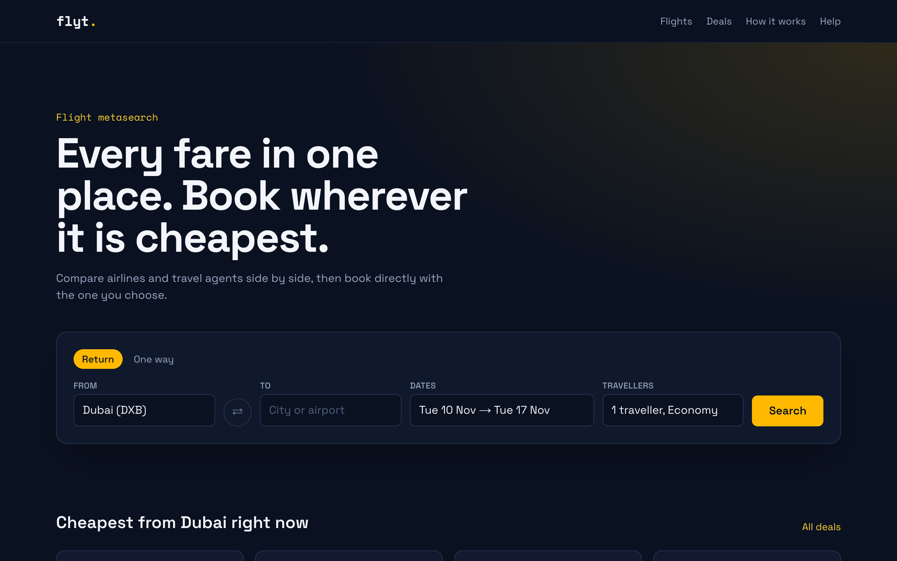
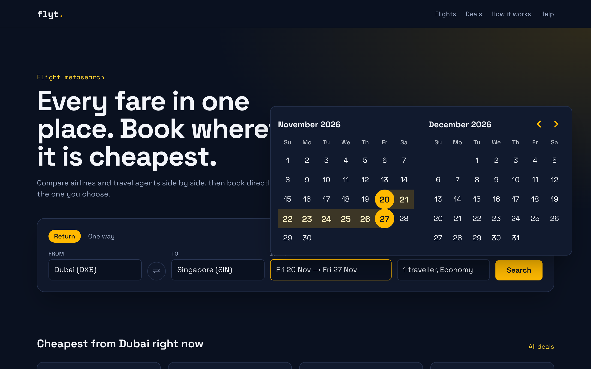
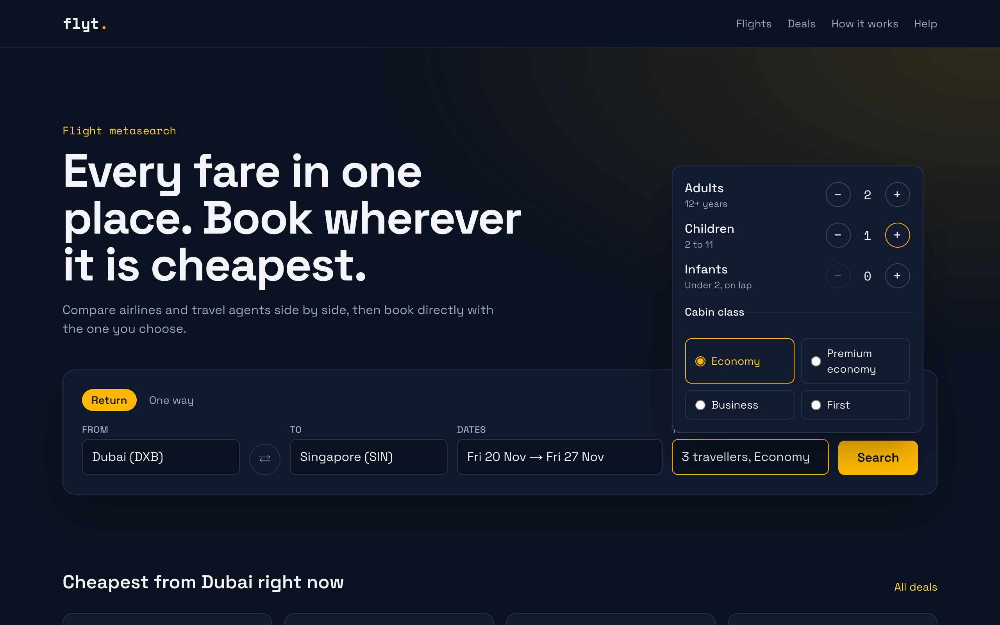
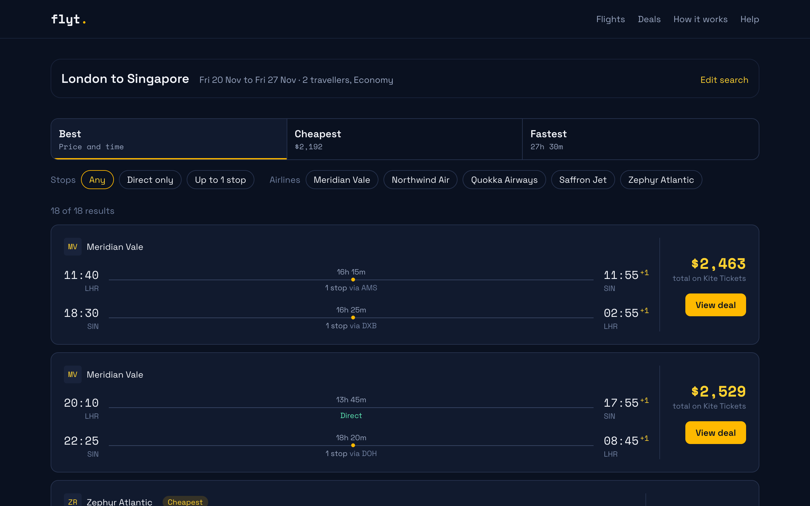
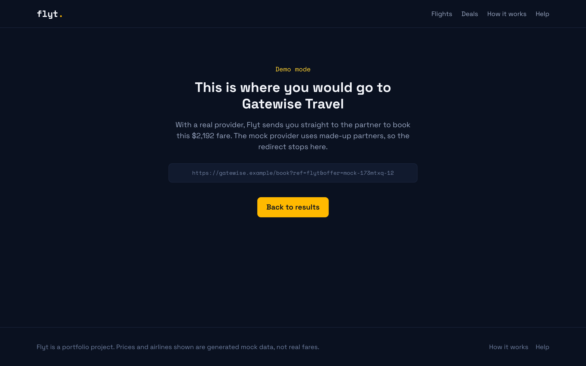
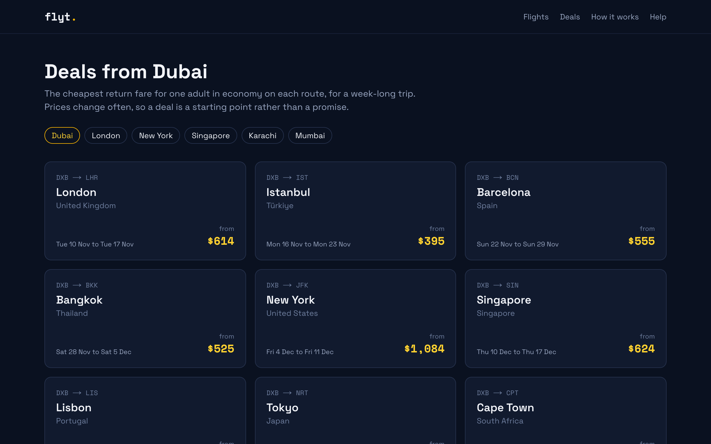
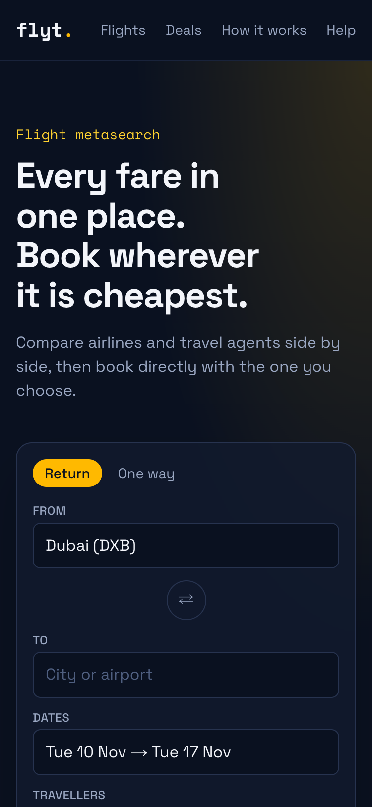
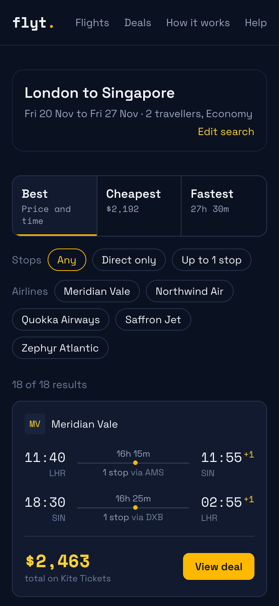
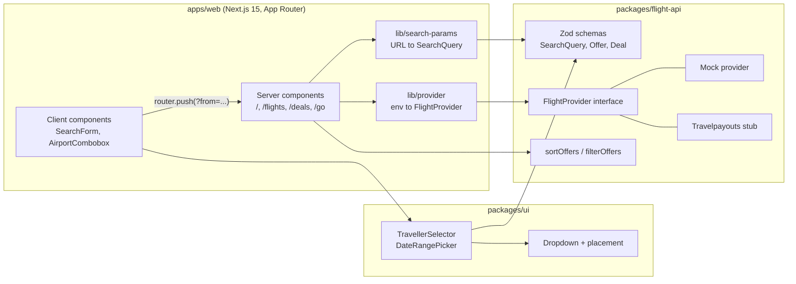

# Flyt

**Flight metasearch on the redirect model: search once, compare every fare, book with the partner.**

Flyt asks airlines and travel agents for prices on a route, shows them side by side, and hands the traveller to whichever partner they pick. It never sells a ticket itself. This repository is the full front end and domain layer of that product, running on a deterministic mock data provider so it works with no API keys.



**Demo video:** [docs/demo/flyt-demo.mp4](docs/demo/flyt-demo.mp4) (42 seconds, captioned, recorded from a local production build). Flyt is not deployed anywhere public yet; see [Getting started](#getting-started) to run it in about a minute.

---

## Why metasearch, and what this project shows

Booking a flight usually means checking the same route on five sites. A metasearch engine does that legwork: it collects fares from many sellers, puts them on one page, and earns a referral fee when you click through. The hard parts are not the booking (partners do that) but the search experience and the data contract:

- A search form that cannot produce an invalid query: real airline rules on party size, infants and dates.
- Results that are fast to scan and honest to compare: totals for everyone, journey times with connections, sorting that does not hide the trade-off between price and time.
- A clean seam between the UI and wherever the fares come from, so swapping a mock for a real supplier does not touch a single page.

Flyt is built around that seam. The UI only talks to a `FlightProvider` interface. Today a mock implements it; a Travelpayouts provider sits behind the same interface as a stub.

## Features

### Search that only produces valid queries

Airport autocomplete matches city, code, airport name or country, with full keyboard support. Return and one-way trips use a range picker built on react-day-picker. The traveller selector enforces the same rules the API schema does: at least one adult, at most 9 people, and no more lap infants than adults. Steppers disable themselves at each limit instead of showing an error afterwards.

| Date range picker                                                                       | Traveller selector                                                                           |
| --------------------------------------------------------------------------------------- | -------------------------------------------------------------------------------------------- |
|  |  |

Both panels use a shared `Dropdown` that measures itself before paint and opens above or below, left or right, depending on the space in the viewport. On a phone it nudges itself back on screen and the calendar drops to one month.

### Results you can sort, filter and share

`/flights` is server rendered from the URL, so a search is a link you can bookmark or send. Tabs sort by **Best** (price and journey time weighed equally), **Cheapest** or **Fastest**, and each tab shows the winning figure for the current filters. Stop and airline filters are plain links, so they work without client JavaScript and the back button behaves.



### The redirect step, without an open redirect

"View deal" goes to `/go`, the point where a metasearch site hands over to the partner. Instead of trusting a destination URL from the query string, `/go` re-runs the search and looks the offer up by ID. A forged offer gets a 404, and the page cannot be abused to bounce users to arbitrary sites. With the mock provider the hand-off stops on a demo page that shows the partner link it would follow.



### Deals that match the results

`/deals` lists the cheapest week-long return fare per route from a chosen city. Each deal is computed with the same generator the search uses, so clicking a deal lands on results whose cheapest fare is exactly the advertised price. There is a unit test for that guarantee.



### Works on a phone

| Home                                                                              | Results                                                                            |
| --------------------------------------------------------------------------------- | ---------------------------------------------------------------------------------- |
|  |  |

`/how-it-works` and `/help` explain the business model and common questions in plain language.

## Demo walkthrough

The video follows one trip end to end: search Dubai to Singapore, pick dates, try to add too many infants, sort and filter the results, hand off to a partner, then open a deal and confirm its price. The script with captions is in [docs/demo/RECORDING.md](docs/demo/RECORDING.md).

To try the same flow yourself, run the app and open:

```
http://localhost:6801/flights?from=LHR&to=SIN&depart=2026-11-20&return=2026-11-27&adults=2&cabin=economy
```

## Architecture



A search is just a URL. The browser submits the form by navigating to `/flights?from=LHR&to=SIN&...`. The server component parses that through the shared Zod schema, asks the provider for offers, filters and sorts them, and renders HTML. No client state store, no API route in between.

### Decisions worth calling out

- **The schema is the single source of booking rules.** `TravellersSchema` and `SearchQuerySchema` in `flight-api` define the limits. The URL parser validates against them, the providers validate against them, and the traveller steppers compute their bounds from the same constants. A tampered URL like `?adults=1&infants=2` gets a clear message, not a broken page.
- **Money is integer minor units.** Prices are cents, so totals across travellers never pick up float error. Display rounds up so the headline is never lower than what the partner charges.
- **Times are local to each airport,** as on a ticket. The mock computes arrival from UTC offsets, which is how the "+1" day markers on overnight flights stay correct.
- **The mock is deterministic.** A seeded PRNG keyed on route, dates and cabin means a results page, its `/go` redirect, a deal and a unit test all see identical offers. Travellers are left out of the seed: adding a passenger changes the total, not the flights. Routes are realistic enough to read: durations from great-circle distance, no nonstops on 17,000 km routes, and connections that stay within 1.5x the direct distance.
- **Workspace packages ship TypeScript source.** Next compiles them via `transpilePackages`, so there is no package build step and no stale `dist` folders.
- **Formatting helpers live outside `'use client'` files.** Server components import `formatIsoDate` and `summarizeTravellers` from `@flyt/ui`; if those lived in client modules, Next would turn them into client references and server rendering would fail. This was a real bug found while testing in the browser.

## Data model

The provider contract, from `packages/flight-api/src/schemas.ts`:

```ts
interface FlightProvider {
  readonly id: string;
  search(query: SearchQuery, options?: { signal?: AbortSignal }): Promise<Offer[]>;
  deals(origin: IataCode, options?: { signal?: AbortSignal }): Promise<Deal[]>;
}

type SearchQuery = {
  origin: string; // IATA, e.g. "LHR"
  destination: string;
  departDate: string; // "2026-11-20"
  returnDate?: string; // omitted for one-way
  travellers: { adults: number; children: number; infants: number };
  cabin: 'economy' | 'premium_economy' | 'business' | 'first';
};

type Offer = {
  id: string;
  outbound: Leg; // segments, durationMinutes, stops
  inbound?: Leg;
  price: { amount: number; currency: string }; // minor units, total for all travellers
  agent: { id: string; name: string };
  deepLink: string; // where /go sends the traveller
};
```

Providers throw a typed `ProviderError` with a code (`invalid_query`, `not_configured`, `not_implemented`, `upstream_failed`, `invalid_response`). The results page shows those as a readable message; anything else goes to the error boundary.

## Tech stack

| Area       | Used                                                                                                        |
| ---------- | ----------------------------------------------------------------------------------------------------------- |
| Frontend   | Next.js 15.5 (App Router, server components), React 19, TypeScript 5.9 (strict, `noUncheckedIndexedAccess`) |
| Styling    | Tailwind CSS 4 with shared theme tokens, Space Grotesk and Space Mono via `next/font`                       |
| Components | react-day-picker 9 for the calendar; dropdown, combobox and steppers written in-house                       |
| Validation | Zod 4 for queries, offers, environment config                                                               |
| Monorepo   | pnpm 10 workspaces, Turborepo                                                                               |
| Testing    | Vitest 3, Testing Library, jsdom                                                                            |
| Tooling    | ESLint 9 (flat config, typescript-eslint, react-hooks, Next plugin), Prettier, GitHub Actions               |

ESLint 9 and TypeScript 5.9 are deliberate: Next 15 does not support the newer majors yet.

## Getting started

Prerequisites: Node 22.13 or newer (`.nvmrc` says 22) and pnpm 10 (pinned in `package.json`; `corepack enable` picks it up).

```bash
nvm use
pnpm install
pnpm dev
```

Open http://localhost:6801. The mock provider needs no configuration.

Production build:

```bash
pnpm build
pnpm --filter @flyt/web start
```

### Environment

Copy `apps/web/.env.example` to `apps/web/.env.local` only if you want to try the provider switch:

| Variable               | Default | Purpose                                                                      |
| ---------------------- | ------- | ---------------------------------------------------------------------------- |
| `FLIGHT_PROVIDER`      | `mock`  | `mock` or `travelpayouts`                                                    |
| `TRAVELPAYOUTS_TOKEN`  | none    | Required when `FLIGHT_PROVIDER=travelpayouts`; startup fails fast without it |
| `TRAVELPAYOUTS_MARKER` | none    | Affiliate marker for partner links                                           |

With `travelpayouts` selected, searches show a "not implemented yet" message, because that provider does not fetch yet.

## Project structure

```
apps/web/src
  app/                 Routes: page.tsx (home), flights/, go/, deals/, how-it-works/, help/
  components/          SearchForm, AirportCombobox, OfferCard, ResultsToolbar, DealCard
  lib/                 search-params (URL <-> query), provider (env -> provider), format
packages/flight-api/src
  schemas.ts           Zod schemas and types
  provider.ts          FlightProvider interface, ProviderError
  providers/           mock.ts, travelpayouts.ts
  results.ts           sorting and filtering
  airports.ts          30 airports with coordinates and UTC offsets
packages/ui/src        Dropdown, placement maths, TravellerSelector, DateRangePicker, theme tokens
packages/config        Shared tsconfig and ESLint config
docs/                  Screenshots and the demo video
```

## Testing and quality

| Command             | What it runs                    |
| ------------------- | ------------------------------- |
| `pnpm test`         | Vitest in all three packages    |
| `pnpm lint`         | ESLint in every package         |
| `pnpm typecheck`    | `tsc --noEmit` in every package |
| `pnpm format:check` | Prettier                        |
| `pnpm build`        | Production build of the web app |

CI (`.github/workflows/ci.yml`) runs all five on every push to `main` and every pull request.

What the tests cover:

- **flight-api:** schema rules and edge cases (impossible dates, same-day returns, the infant rule), time zone conversion across the date line, sort and filter behaviour, and the mock's guarantees: deterministic output, connected segments, durations matching timestamps, prices scaling with travellers, connections close to the direct route, deal prices matching search results. Also the Travelpayouts request mapping, including that the token never ends up in the URL.
- **ui:** placement maths (flip, align, nudge, height cap), stepper bounds, keyboard and outside-click closing, focus return, date range selection and reset.
- **web:** URL parsing and round-tripping with clear messages for missing fields, provider selection from env, formatting, and the search form flow with a mocked router.

Last local run: lint, typecheck, format check and build passed, and all 88 tests passed. Beyond unit tests, every page was clicked through in a browser at desktop and 375px width, and a headless Chromium script loaded each route at both sizes checking status codes, console errors and horizontal overflow. There are no committed end-to-end tests yet, and CI has not run on GitHub because the repository has not been pushed.

## Deployment

Not deployed. The app is a standard Next.js build with no database or secrets in mock mode, so any Node host that runs `next start` would work, but no hosting is set up.

## Status and limitations

- **No live fares.** Travelpayouts is a stub that maps a search to its API URL and stops. Its Data API returns cached cheapest prices rather than full itineraries, so the real integration needs a mapping into the `Offer` shape and a decision about cabin and passenger data it does not carry.
- **Mock simplifications.** Daylight saving is ignored (UTC offsets are standard time), prices are USD only, and airlines and agents are fictional on purpose so nobody mistakes them for real fares.
- **`/go` re-runs the search.** Cheap with the mock; a real provider would need offers cached between the results page and the redirect.

## Roadmap

Planned, not built:

1. A working Travelpayouts provider with response validation and caching.
2. Streaming results as each partner responds, instead of one blocking search.
3. Playwright end-to-end tests for the search, filter and redirect flow in CI.
4. Currency selection.

## License

MIT, see [LICENSE](LICENSE).

Built by Usama Khaki. More work at [github.com/UsamaKhaki](https://github.com/UsamaKhaki).
